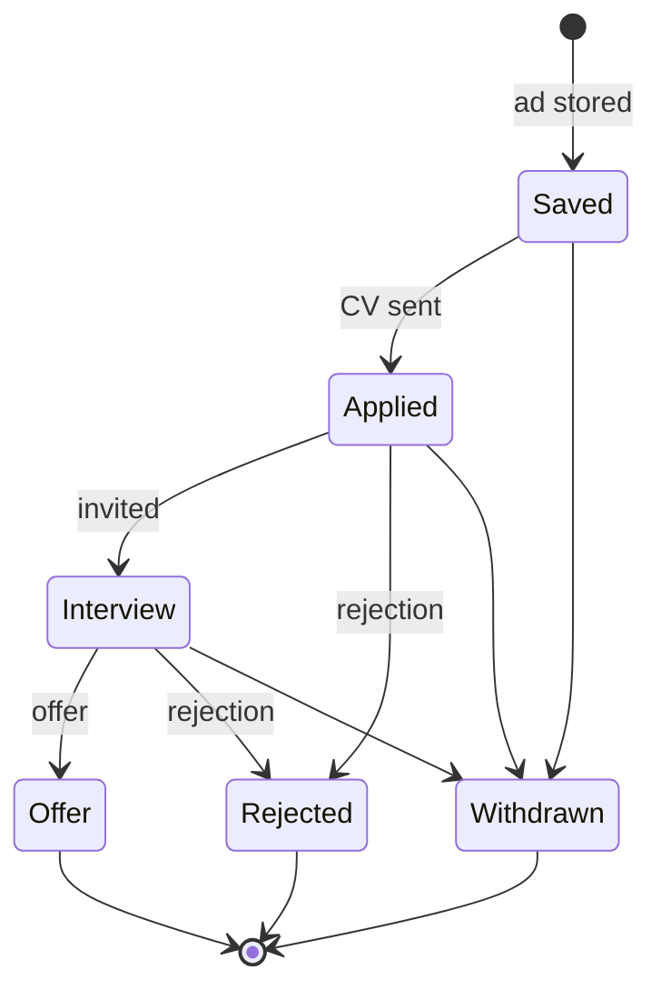
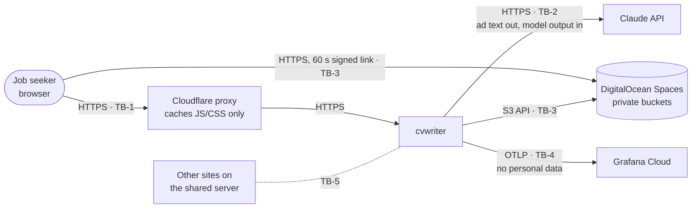
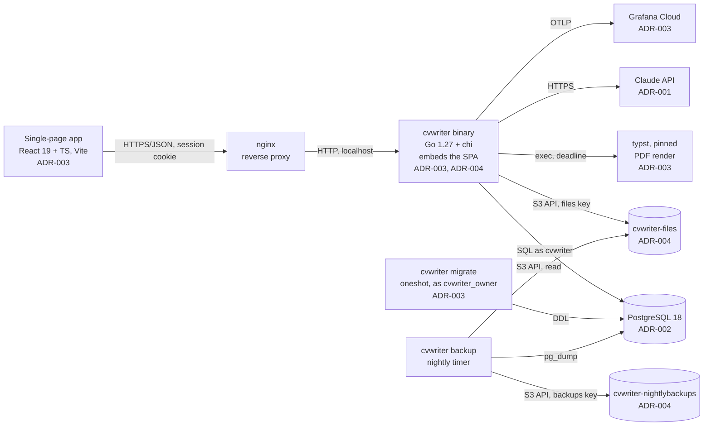

# Architecture: cvwriter

<!-- prd-interviewer-Opus5.5-agent, 2026-10-19. From docs/claude-pkg/TEMPLATE-ARCHITECTURE.md.
     Status: draft, awaiting the owner's approval. Leans marked (OQ-n) are open. -->

Last updated: 2026-10-19, first draft (depends on ADR-003 and ADR-004)

## Domain model

### Entities and invariants
| Entity | Owns | Invariants (what must always be true) | ADR |
|---|---|---|---|
| User (`users`) | Email, password hash | One row for now. Every other row belongs to exactly one user. The password hash is argon2id (OQ-3). | ADR-002 |
| Session (`sessions`) | Who is signed in | Only a hash of the session token is stored. A session expires 14 days after it was last used, and on sign-out it is deleted. The cookie is HttpOnly, Secure, SameSite=Strict (brief) (OQ-3). | — |
| API key (`api_keys`) | The user's Claude key, encrypted | At most one per user. AES-256-GCM with `user_id` as associated data and a `key_version`; only the last 4 characters are ever shown. It is stored only after a test call succeeds. | ADR-001 |
| Ad (`ads`) | The pasted ad and its analysis | `raw_ad` never changes. An ad is stored only with an analysis that passed its schema check; a failed analysis stores nothing (OQ-4). The list columns, `search_vector` and `keyword_terms` are generated from `analysis` and can't drift. | ADR-002 |
| Reference CV (`reference_cvs`) | The user's past CV text | Feature 1: one, pasted as text. Feature 2: many, uploaded; the original file is in the files bucket, the extracted text here; each can be ticked as a source of proof. | ADR-004 |
| CV version (`cv_versions`) | One generated CV | Insert-only (grants plus a trigger). `version_no` counts up from 1 per ad, unique per ad. A row exists only after its PDF passed the 2-page and ATS checks and was uploaded; it stores the CV JSON, the Markdown, the object key, the PDF's SHA-256 and size, and the design. | ADR-002, ADR-003, ADR-004 |
| CV flag (`cv_flags`) | "Not good" feedback | Insert-only, at most one per CV version, with a reason (wrong main problem, wrong keywords, too long, wording, other) and an optional note. It is a separate table because a CV version can't be updated (OQ-2). | ADR-002 |
| Claude call (`claude_calls`) | Usage and spend | Insert-only. Exactly one row per call, success or failure, with the model that answered, the token counts, the price at the time, the cost in micro-dollars and the duration. | ADR-001, ADR-002 |
| Application status (`application_events`), Feature 2 | Where each application stands | Insert-only events; an ad's current status is its latest event. | — |

### Relationships
- A user has many sessions, ads, reference CVs and Claude calls, and at most one API key.
- An ad has many CV versions; a CV version belongs to exactly one ad.
- A CV version has at most one CV flag.
- A CV version references the Claude call that wrote it; an ad references the Claude call that analysed it. A Claude call belongs to at most one of them (a failed call belongs to neither).
- Feature 2: an ad has many application events.

### State machines
- **Ad, CV version, CV flag, Claude call:** none. Each is written once, complete, or not at all.
- **Application status (Feature 2):** the states below. Any state can move to Withdrawn.

## Context diagram
Trust boundaries (TB-n) are defined in `specs/threat-model.md`.

## Container diagram

- The **app**, **migrate** and **backup** are the same binary run three ways, each as its own systemd unit with only its own credentials.
- **typst** runs as a child process of the app, in a fresh temporary folder, one render at a time.
- The SPA is served by the app (`index.html` no-cache, hashed assets immutable) and cached by Cloudflare. API routes bypass the cache.

## Module boundaries
Go modules live under `internal/<module>/`; others import only `internal/<module>/api` (ADR-003).

| Module | Owns | Others reach it through |
|---|---|---|
| `account` | `users`, `sessions`, `api_keys` | `CurrentUser(ctx)`; `DecryptKey(ctx, userID)`, which only `claude` may call (depguard) |
| `ads` | `ads` | `Create`, `Get`, `List`, `Search` |
| `cvs` | `cv_versions`, `cv_flags`, `reference_cvs` | `Generate`, `ListVersions`, `Flag`, `DownloadLink`, `ReferenceText` |
| `usage` | `claude_calls` | `Record`, `MonthSpend`, `Summary` |
| `claude` | no tables | `Analyse`, `WriteCV` (streamed); the only importer of the Anthropic SDK; checks spend through `usage` before each call |
| `pdf` | no tables | `Render(cvJSON, design) → PDF, pages, text`; the only module that runs `typst` |
| `storage` | objects in both buckets | `PutNew`, `SignGet`, `Verify`; no overwrite or delete exists |
| `status` (Feature 2) | `application_events` | `Record`, `Current`, `InterviewRate` |

Every query on a user-owned table filters on `user_id`; a CI check enforces it (ADR-004).

## Operations

### Server units
| Unit | Runs | Credentials (`LoadCredential=`) | Limits |
|---|---|---|---|
| `cvwriter.service` | The app, as user `cvwriter`, on localhost behind nginx | `master-key` (ADR-001), `files-key` (ADR-004) | `MemoryMax=`, `GOMEMLIMIT` from memory measured in the walking skeleton; `Restart=on-failure` |
| `cvwriter-migrate.service` | Oneshot, `cvwriter migrate`, as `cvwriter_owner` | `db-owner-password` | Started only by deploy |
| `cvwriter-backup.service` + `.timer` | Oneshot, nightly; monthly it also runs the restore test | `backups-key`, `files-key` (read for the fingerprint check), `db-owner-password`, `age-key` | `Nice=`, `IOSchedulingClass=idle` |

Hardening on every unit: `NoNewPrivileges=yes`, `ProtectSystem=strict`, `ProtectHome=yes`, `PrivateTmp=yes`, `IPAddressDeny=169.254.169.254`. The app unit is the only one nginx reaches.

### One-time setup
1. As the database superuser: create roles `cvwriter_owner` (LOGIN, owns database `cvwriter`) and `cvwriter` (LOGIN, CONNECT only). Neither is a superuser (ADR-002).
2. Create both Spaces buckets, enable versioning through the API, create one key per bucket (ADR-004).
3. Install the credentials as root-only files (mode 0400) referenced by the units.
4. Keep a copy of the master key offline, never in a bucket or in git (ADR-002).

### Deploy order (every merge to `main`)
1. CI builds the binary (SPA embedded, `CGO_ENABLED=0`, linux/amd64) and fetches `typst` by pinned version and SHA-256.
2. Copy both to a new release folder on the server.
3. Back up the database (the same dump as the nightly job).
4. Run `cvwriter-migrate.service` with the new binary. Migrations are compatible with the running binary (ADR-003).
5. Switch the `current` link to the new release and restart `cvwriter.service`.
6. Smoke test: health check, then a signed link to the canary object (ADR-004). On failure, switch the link back and restart; the schema stays as it is.

### Backups and restore
- **Nightly:**
  - `pg_dump -Fc` of `cvwriter`, encrypted with `age`, uploaded to `cvwriter-nightlybackups` as `db/<date>.dump.age` (OQ-1).
  - The encryption protects the dumps if the bucket or its key leaks. Its private key is a server credential (for the restore test), and the owner keeps a copy offline with the master key, so a lost server doesn't lose the backups.
  - Then every object in `cvwriter-files` is checked against the SHA-256 and size stored in `cv_versions` and `reference_cvs`.
  - Success writes a metric. An alert fires when no success has happened in 26 hours, or on any mismatch.
- **Retention:** dumps are kept 90 days. Files rely on versioning, and older versions are kept (ADR-004).
- **Restore test** (OQ-5):
  - Monthly, automated: the latest dump is decrypted and restored into a scratch database. The job checks row counts against production, then drops the scratch database. A failure alerts.
- **Accepted risk:** files and backups share one provider and one account (ADR-004).

### Telemetry
- Traces and metrics go over OTLP to Grafana Cloud. Browser spans are relayed by the app; the relay requires login and has size and rate limits (ADR-003).
- An uptime probe hits `/cvwriter/api/health`.
- Alerts: the uptime probe, the backup's last success, Claude spend at $20, and the nightly fingerprint check.

## Open questions
- **OQ-1** Encrypt the nightly dumps with `age`? Lean: yes.
- **OQ-2** "Not good" flags in their own insert-only table? Lean: yes.
- **OQ-3** Server-side sessions in Postgres, passwords hashed with argon2id? Lean: yes.
- **OQ-4** A failed analysis stores nothing, and the paste stays in the box with Retry? Lean: yes.
- **OQ-5** An automated monthly restore test? Lean: yes.
