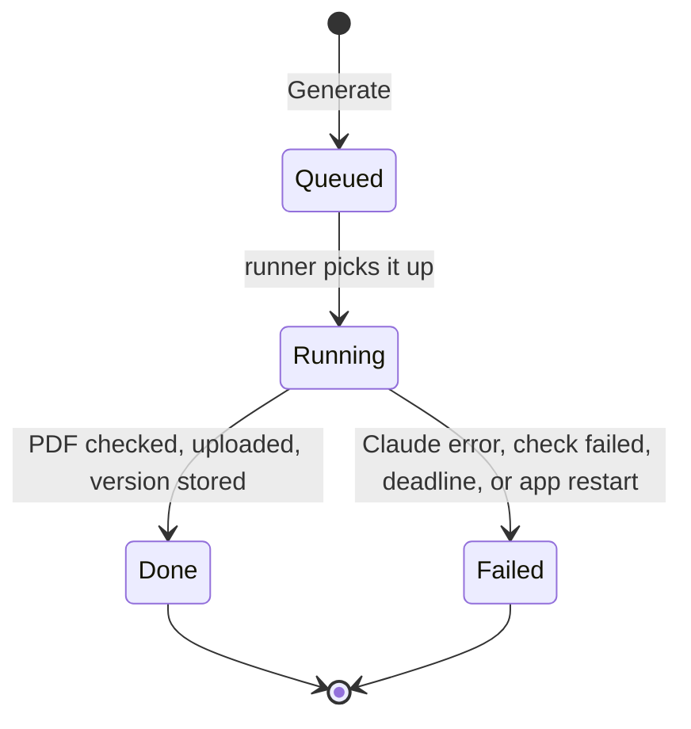
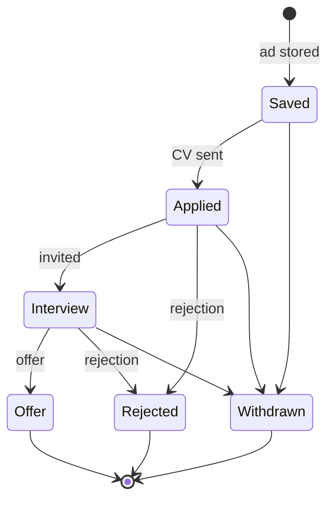
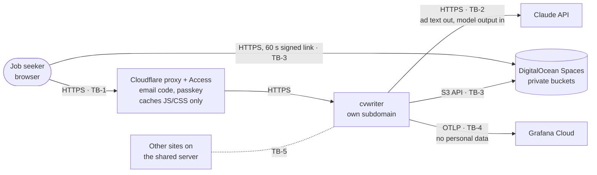
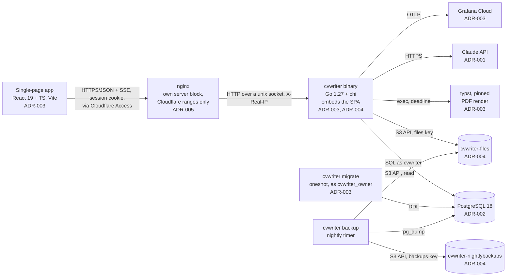

# Architecture: cvwriter

<!-- prd-interviewer-Opus5.5-agent, 2026-10-19. From docs/claude-pkg/TEMPLATE-ARCHITECTURE.md.
     Status: draft, awaiting the owner's approval.
     senior-lead-Opus5.5-agent, 2026-10-20: pre-skeleton spike results (ADR-006), go-live. -->

Last updated: 2026-10-20, spike results from before the walking skeleton (ADR-006)

## Domain model

### Entities and invariants
| Entity | Owns | Invariants (what must always be true) | ADR |
|---|---|---|---|
| User (`users`) | Email, password hash, timezone, spend alert and stop, the CV contact block | One row for now; every other row belongs to exactly one user. The password hash is argon2id. Timezone and spend limits are per user; new users get the defaults from the environment. The contact block (name, phone, email, address, links) is edited in Settings, never sent to Claude, and added to the CV by the Typst template at render. | ADR-002 |
| Session (`sessions`) | Who is signed in | Only the SHA-256 of a random 32-byte token is stored. A session ends 14 days after last use, 30 days after creation, on sign-out, or when the password changes. Last use is written at most once an hour. | — |
| Security event (`security_events`) | Who changed what, for incidents | Insert-only (grants plus a trigger). `kind` is `signed_in`, `sign_in_failed`, `signed_out`, `password_changed`, `api_key_changed` or `sessions_ended`, with the time, the session's id and the client IP; a key change records only the last 4 characters. Failed sign-ins are recorded only for an existing account (unknown emails stay in `login_attempts`). Never a password, key or token. The client IP is cleared after 90 days. | ADR-002 |
| Login attempt (`login_attempts`) | Recent failed sign-ins | Counted per account and per client IP; each failure lengthens the wait before the next try. An account is never locked. Rows older than 24 hours are deleted, so client IPs aren't kept. | — |
| API key (`api_keys`) | The user's Claude key, encrypted | At most one per user. AES-256-GCM with `user_id` as associated data and a `key_version`; only the last 4 characters are ever shown; stored only after a test call succeeds. Changing it needs the current password. | ADR-001 |
| Ad (`ads`) | The pasted ad and its analysis | `raw_ad` never changes. An ad is stored only with an analysis that passed its schema check; a failed analysis stores no ad. The list columns, `search_vector` and `keyword_terms` are generated from `analysis`. | ADR-002 |
| Reference CV (`reference_cvs`) | The user's past CV text | Feature 1: one, pasted as text. Feature 2: many, uploaded; the original file in the files bucket, the extracted text here, each tickable as a source of proof. | ADR-004 |
| CV job (`cv_jobs`) | One run of Generate | At most one queued or running job per ad. It ends as done (with its CV version) or failed (with a reason). A job still running when the app restarts is marked failed. | ADR-003 |
| CV version (`cv_versions`) | One generated CV | Insert-only (grants plus a trigger). `version_no` counts up from 1 per ad. A row exists only after its PDF passed the 2-page and ATS checks and was uploaded; it stores the CV JSON, the Markdown, the object key, the PDF's SHA-256 and size, and the design. | ADR-002, ADR-003, ADR-004 |
| CV event (`cv_events`) | Downloads and "Not good" feedback | Insert-only. `kind` is `downloaded`, `flagged` or `unflagged`. A reason (wrong main problem, wrong keywords, too long, wording, other) is required for `flagged` and absent otherwise; a note is optional. Reasons are text with a CHECK. A version's flag state is its latest `flagged` or `unflagged` event. A download records only the time and the version. | ADR-002 |
| Claude call (`claude_calls`) | Usage and spend | Insert-only. Exactly one row per call, success or failure, with the model that answered, token counts, the price at the time, the cost in micro-dollars and the duration. | ADR-001, ADR-002 |
| Application event (`application_events`), Feature 2 | Where each application stands | Insert-only; an ad's status is its latest event. | — |

### Relationships
- A user has many sessions, security events, login attempts, ads, reference CVs and Claude calls, and at most one API key.
- An ad has many CV jobs and many CV versions. A done CV job has exactly one CV version; a CV version comes from exactly one job.
- A CV version has many CV events.
- An ad references the Claude call that analysed it; a CV version references the Claude call that wrote it. A failed call belongs to neither.
- Feature 2: an ad has many application events.

### State machines
- **Ad, CV version, CV event, Claude call:** none. Each is written once, complete, or not at all.

**CV job:**

**Application status (Feature 2):** any state before Offer can also move to Withdrawn.

## Context diagram
Trust boundaries (TB-n) are defined in `specs/threat-model.md`.

## Container diagram

- The **app**, **migrate** and **backup** are one binary run three ways, each as its own systemd unit holding only its own credentials.
- The app is served at the root of its own subdomain (ADR-005): the SPA at `/`, the API under `/api/`, hashed assets under `/assets/`.
- **Generate runs as a job:** `POST /api/ads/{id}/cv-jobs` returns a job id at once, and `GET /api/cv-jobs/{id}/events` streams progress over SSE (writing, rendering, checking, saved or failed). The job runs inside the app, one at a time, and keeps running if the browser leaves. Moving it to a separate worker later changes where it runs, not the API.
- **typst** runs as a child process of the job, in a fresh temporary folder, with its own deadline.

## Sign-in
- **In front: Cloudflare Access** on the whole subdomain. Policy: Allow, Include, Emails = the owner's address (never "Login Methods", which lets anyone in). Login method: One-time PIN only. Independent MFA: Biometrics (Touch ID on the owner's laptop). Session: 24 h. A second Access app for `/api/health` only, with a Bypass policy, keeps the uptime probe working; it returns no data.
- **Origin check:** the nginx server block accepts only Cloudflare's address ranges (the server's existing Cloudflare-only rule). The app checks `Cf-Access-Jwt-Assertion` on every request except `/api/health`: RS256 against the team's published keys (fetched and cached; they rotate), `iss` = the team domain, `aud` = the Access app's AUD tag, `exp`, and the `email` claim equal to the account's email. Anything else gets 401. The team domain and AUD tag are config, not secrets. Library: `coreos/go-oidc`.
- **Cookie:** `__Host-session`; HttpOnly, Secure, SameSite=Strict, Path=/. It holds the session token; the database holds only its hash. Signing in always issues a new token.
- **Requests:** the API accepts only JSON bodies, and checks `Origin` on every request that changes data.
- **Passwords:** argon2id at OWASP's recommended settings, at most 2 hashes computed at a time. An unknown email gets the same error and the same delay as a wrong password, because a dummy hash is checked.
- **Throttling:** failed sign-ins lengthen the wait per account and per client IP (from `X-Real-IP`, which nginx sets from Cloudflare's header, trusted only from Cloudflare's ranges). Never a lock.
- **Sensitive changes:** changing the password or the API key needs the current password; a new password ends every other session.
- **Forgotten password (one user):** `cvwriter set-password` on the server. Email reset comes with a second user.

## Module boundaries
Go modules live under `internal/<module>/`; others import only `internal/<module>/api` (ADR-003).

| Module | Owns | Others reach it through |
|---|---|---|
| `account` | `users`, `sessions`, `security_events`, `login_attempts`, `api_keys` | `CurrentUser(ctx)`, `Settings(ctx)`; `DecryptKey(ctx, userID)`, which only `claude` may call (depguard) |
| `ads` | `ads` | `Create`, `Get`, `List`, `Search` |
| `cvs` | `cv_jobs`, `cv_versions`, `cv_events`, `reference_cvs` | `StartJob`, `JobEvents`, `ListVersions`, `Flag`, `Unflag`, `DownloadLink`, `ReferenceText` |
| `usage` | `claude_calls` | `Record`, `MonthSpend`, `Summary` |
| `claude` | no tables | `Analyse`, `WriteCV` (streamed); the only importer of the Anthropic SDK; checks spend through `usage` before each call; replaces any contact-block value found in the text with a placeholder before sending (a test checks no contact value reaches a prompt) |
| `pdf` | no tables | `Render(cvJSON, design) → PDF, pages, text`; the only module that runs `typst` |
| `storage` | objects in both buckets | `PutNew`, `SignGet`, `Verify`; no overwrite or delete exists |
| `status` (Feature 2) | `application_events` | `Record`, `Current`, `InterviewRate` |

Every query on a user-owned table filters on `user_id`; a CI check enforces it (ADR-004).

## Operations

### Server units
| Unit | Runs | Credentials (`LoadCredential=`) | Limits |
|---|---|---|---|
| `cvwriter.socket` | The unix socket `/run/cvwriter.sock`, owned by `cvwriter`, group `www-data`, mode 0660: only nginx's user can open it, and there is no TCP port | — | — |
| `cvwriter.service` | The app, as user `cvwriter`, on the socket from `cvwriter.socket`, behind nginx | `master-key` (ADR-001), `files-key` (ADR-004) | `MemoryMax=`, `GOMEMLIMIT` from memory measured in the walking skeleton (a baseline; measured again with PDF rendering, ADR-006); `Restart=on-failure` |
| `cvwriter-migrate.service` | Oneshot, `cvwriter migrate`, as `cvwriter_owner` | `db-owner-password` | Started only by deploy |
| `cvwriter-backup.service` + `.timer` | Oneshot, nightly; monthly it also runs the restore test | `backups-key`, `files-key` (read for the fingerprint check), `db-owner-password`, `age-key` | `Nice=`, `IOSchedulingClass=idle` |

Hardening on every unit: `NoNewPrivileges=yes`, `ProtectSystem=strict`, `ProtectHome=yes`, `PrivateTmp=yes`, `IPAddressDeny=169.254.169.254`. nginx reaches only the app unit. A test checks the socket's owner, group and mode.

### One-time setup
1. As the database superuser: create roles `cvwriter_owner` (LOGIN, owns database `cvwriter`) and `cvwriter` (LOGIN, CONNECT only). Neither is a superuser (ADR-002).
2. Create both Spaces buckets, enable versioning through the API, and create one key per bucket (ADR-004). Spaces can't make a key that writes without deleting: a Read/Write key can delete an old version, though not suspend versioning or add a lifecycle rule (checked 2026-10-20, ADR-006). Until ADR-004's trigger adds a locked second copy, the keys stay one per bucket, and the backup job runs as its own user.
3. Create an `age` key pair. Install the private key and every other credential as root-only files (mode 0400) referenced by the units.
4. The owner keeps an offline copy of the master key and the `age` private key, never in a bucket or in git, and decrypts one dump with that copy to prove it works.
5. The subdomain (ADR-005): a proxied DNS record at Cloudflare, an nginx server block with a certificate, and `proxy_set_header X-Real-IP $remote_addr`. The old path on the shared site redirects to the subdomain, with or without a trailing slash, keeping the rest of the path: `302` until the subdomain is verified, then `301`. The Access apps (step 7) exist before the DNS record does.
6. Before go-live (threat model, "Go-live"), on the shared server: no service runs as an account that can use sudo, and every account with full sudo is a named admin account in use. A log shipper sends SSH sign-ins and sudo events to Grafana Cloud.
7. Cloudflare Access (Sign-in): turn on Zero Trust on the free plan; independent MFA with Biometrics is offered there (checked 2026-10-20). Add the One-time PIN identity provider; allow Biometrics only, not applied to all apps; enrol the laptop's Touch ID; create both Access apps; put the AUD tag in the app's config. The Cloudflare account itself has its own second factor.

### Deploy order (every merge to `main`)
CI only calls `scripts/deploy.sh`; every step below lives in that script, so a deploy by hand when CI is down runs exactly the same steps (threat model, T-41).

1. CI builds the binary (SPA embedded, `CGO_ENABLED=0`, linux/amd64) and fetches `typst` by pinned version and SHA-256.
2. Copy both to a new release folder on the server.
3. Back up the database (the same dump as the nightly job).
4. Run `cvwriter-migrate.service` with the new binary. Migrations are compatible with the running binary (ADR-003).
5. Switch the `current` link to the new release and restart `cvwriter.service`. A CV job running at that moment ends as failed and can be retried.
6. Smoke test: the health check, then a signed link to the canary object (ADR-004). On failure, switch the link back and restart; the schema stays.

### Backups and restore
- **Nightly:**
  - `pg_dump -Fc` of `cvwriter`, encrypted with `age` on the server, uploaded to `cvwriter-nightlybackups` as `db/<date>.dump.age`. The plain dump never leaves the server and is deleted after upload.
  - Encryption protects the dumps if the bucket or its key leaks. The private key is a server credential (for the restore test), and the owner's offline copy means a lost server doesn't lose the backups.
  - Every object in `cvwriter-files` is checked against the SHA-256 and size stored in `cv_versions` and `reference_cvs`.
  - Success writes a metric. An alert fires when no success has happened in 26 hours, or on any mismatch.
- **Retention:** dumps are kept 90 days, removed by a lifecycle rule on the bucket, never by the server's code (its key could delete, ADR-006). Files rely on versioning, and older versions are kept (ADR-004).
- **Restore test, monthly and automated:** the latest dump is decrypted, restored into a scratch database, and its row counts are compared with production; then the scratch database is dropped. A failure alerts.
- **Accepted risk:** files and backups share one provider and one account (ADR-004).

### Telemetry
- Traces and metrics go over OTLP to Grafana Cloud. Browser spans are relayed through `/api/telemetry`, which requires sign-in and has size and rate limits (ADR-003).
- An uptime probe hits `/api/health`.
- Alerts: the uptime probe, the backup's last success, the restore test, Claude spend at the user's alert level, the nightly fingerprint check, and an SSH sign-in or sudo use by an account other than the admin account.
- A CV job's SSE stream must survive Cloudflare's 100-second idle limit and nginx's `proxy_read_timeout` (60 s by default): the Generate slice's acceptance criteria cover a heartbeat well under both and nginx buffering turned off for the stream. If the stream still drops, the page polls the job's status instead.

## Scale path
Sized for the PRD's load: one user, ~250 ads and ~500 CV versions a year. Growth is handled by measured triggers, not by building ahead.

**Built for growth from the start (one-way choices):**
- `user_id` on every row and lookup index, and in every query (checked in CI).
- Each API key encrypted with its own user's id.
- Files stored under each user's id.
- uuidv7 ids, so there's no shared counter.
- Insert-only history.
- Generate as a job API.
- Timezone and spend limits per user.
- Its own origin.

| Trigger (measured) | What changes | ADR it would replace or extend |
|---|---|---|
| A second user is wanted | Invites and email password reset; PostgreSQL row-level security; a product decision on who pays for Claude | ADR-002 |
| Free memory at peak under 500 MB, or another tenant affected | Move to its own server | ADR-003 |
| CV job wait over 10 s at p95 | Two jobs at a time, then a separate worker behind the same job API | ADR-003 |
| Search p95 nearing 200 ms | Measure, then tune indexes (`pg_trgm` is already planned) | ADR-002 |
| Two or more app servers | The master key moves to a key service; throttling is already in Postgres | ADR-001 |
| The nightly file check takes over 5 minutes | Check by HEAD and ETag nightly, full hash weekly | ADR-004 |
| First CVs sent to employers, or a Spaces incident | A second, independent backup provider | ADR-004 |
| The telemetry free tier's limits are reached | A paid tier or another OTLP backend (configuration only) | ADR-003 |
